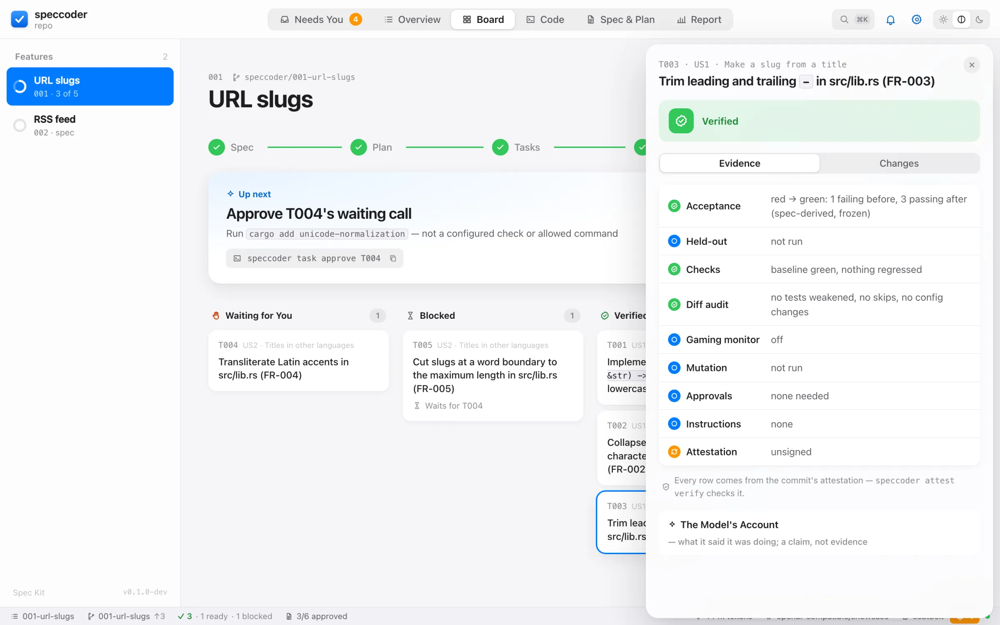
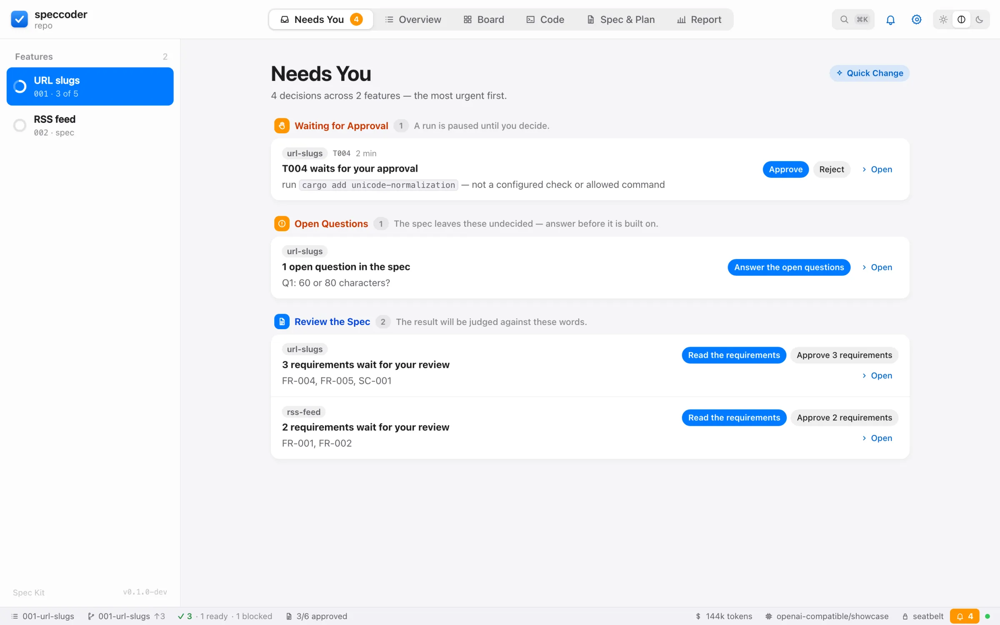
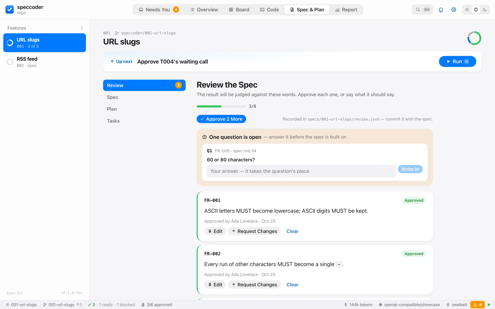
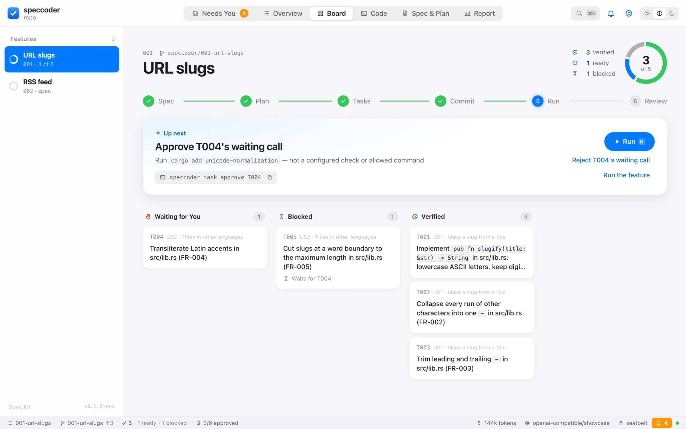
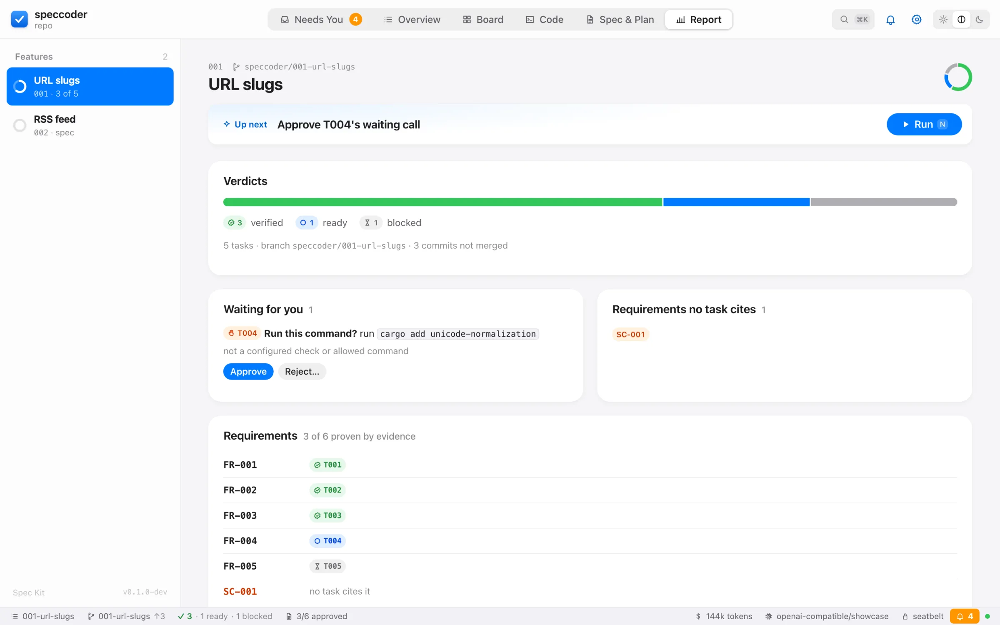

<p align="center">
  
</p>

<h1 align="center">speccoder</h1>

<p align="center">
  <b>Spec-driven coding, decided by evidence.</b><br>
  Implements <a href="https://github.com/github/spec-kit">Spec Kit</a> features and <a href="https://github.com/Fission-AI/OpenSpec">OpenSpec</a> changes task by task — and ticks a task only when tests derived from your spec go from red to green, never on the model's word.
</p>

<p align="center">
  <a href="https://github.com/hupe1980/speccoder/actions/workflows/ci.yml"></a>
  <a href="https://crates.io/crates/speccoder"></a>
  <a href="https://hupe1980.github.io/speccoder/"></a>
  <a href="#-license"></a>
</p>

<p align="center">
  📖 <a href="https://hupe1980.github.io/speccoder/docs/"><b>Documentation</b></a> ·
  🚀 <a href="https://hupe1980.github.io/speccoder/docs/quickstart/">Quickstart</a> ·
  ⚖️ <a href="https://hupe1980.github.io/speccoder/docs/how-it-works/">How it works</a> ·
  🖥️ <a href="https://hupe1980.github.io/speccoder/docs/web/">The app</a> ·
  ⌨️ <a href="https://hupe1980.github.io/speccoder/docs/cli/">CLI</a>
</p>

<picture><source media="(prefers-color-scheme: dark)" srcset="site/static/screenshots/drawer-dark.webp"></picture>

## 💡 Why

Coding agents are good at writing code and too good at declaring victory. speccoder separates the two: a model proposes, and code decides.

- 🧪 **Evidence decides.** The spec's acceptance examples become tests that must fail before the attempt and pass after it; your checks must not regress; the diff is audited for weakened tests; and plausible wrong versions of the change must fail the tests (the acceptance strength on every tick).
- 🔒 **Isolated and sandboxed.** Work happens on `speccoder/<feature>` in a worktree of its own. Every command runs in an OS sandbox (Seatbelt on macOS, Landlock and seccomp on Linux): writes only to the worktree, no credentials, no network beyond loopback.
- 🚦 **Every call governed.** Each tool call is allowed, sent to a person, or denied before it runs. An approval covers the exact object you saw — the file a write reaches, the argv and the program it runs, the MCP tool as defined now — and ends with the run; arguments copied from what the model read can be approved once only. Decisions record who made them — at the terminal, in an editor over ACP, or later.
- 💾 **Durable and replayable.** Every model and tool call is journaled. A killed run resumes without repeating finished calls; a recorded run replays offline.
- 🧾 **Proof a maintainer can check.** Every tick leaves signed in-toto statements in git. `speccoder-verify` — a small static binary, no model key, no network, nothing from the pull request executed — checks each `[X]` against them with the maintainer's trust, and its GitHub Action publishes the result on every push as the `speccoder / evidence` check, which a repository can make required ([proof in pull requests](https://hupe1980.github.io/speccoder/docs/verifier/)).
- 🤖 **Your model, or your agent.** Anthropic, OpenAI, any OpenAI-compatible server (Ollama, vLLM, …), or Claude Code and Codex making the attempts under speccoder's judgement.

## 🚀 Quickstart

You need git, a Spec Kit project (Spec Kit 0.13 to 1.2) or an OpenSpec project (1.0 or newer), and a model.

```sh
brew install hupe1980/tap/speccoder
# or: curl -LsSf https://github.com/hupe1980/speccoder/releases/latest/download/speccoder-installer.sh | sh
# or: cargo binstall speccoder        (the release archive, no build)
# or: cargo install speccoder --locked

cd my-project
export ANTHROPIC_API_KEY=…           # or OPENAI_API_KEY — read from the environment only
speccoder init                       # detects your checks, runs them, offers to commit speccoder.toml
speccoder run                        # works through the feature's tasks
speccoder do "make the login button blue"   # a small change, judged like any other
speccoder bug "saving an empty title crashes" --expected "an empty title is refused"
                                     # a bug: reproduced first, confirmed by you once, fixed on evidence
speccoder review                     # sign off the spec, requirement by requirement
speccoder inbox                      # what waits for your decision, in every feature
speccoder actions                    # what you can do now, each with its command (--json for scripts)
speccoder report                     # every task and the evidence behind its tick
git merge speccoder/001-my-feature   # after reviewing the branch
```

A run at the terminal (`--plain`; at a terminal it is a live dashboard):

```text
▶ T002 Collapse every run of other characters into one `-` in src/lib.rs  (001-url-slugs)
  ✓ baseline
  ✓ red assertion
  · attempt 1/2
    ∴ A single pass that remembers the last character pushed collapses every run.
    “Every run of other characters should become a single dash, so I'll track the last character pushed.”
    turn 1   read_file    src/lib.rs        allow
    turn 2   write_file   src/lib.rs        allow
    turn 3   run_command  cargo test        allow
  ✓ attempt 1/2
  ✓ verify
  ✓ audit
  ✓ commit 4be81c2
✓ T002 verified · 42.5k in / 2170 out · 3s — verdict: verified
```

Then, as you need them:

- 👀 **Watch and decide.** At a terminal, `run` is a live dashboard that asks approvals with one key; [the app](#-the-app) shows the same work. The model's reasoning and words appear beside its calls — its account, never evidence.
- ⚙️ **Automate.** Every command takes `--json` or `--events`, both with [published schemas](https://hupe1980.github.io/speccoder/docs/cli/#json-output); every failure names a [code](https://hupe1980.github.io/speccoder/docs/codes/) and the command that fixes it.
- 🐙 **Work from GitHub.** `speccoder auth login` once; `speccoder issue start 42` specifies a feature from an issue, `speccoder pr` opens a draft whose description is the evidence. No `gh` needed.
- 📝 **Plan with your spec tool.** `speccoder spec specify "…"`, then `plan` and `tasks`, runs Spec Kit's own skills (OpenSpec: `propose`).

## 📸 The app

`speccoder ui` (or `ui --window`) shows the project on your machine, local only. What waits for you comes first; everything else is one click away.

<table>
  <tr>
    <td width="50%"><picture><source media="(prefers-color-scheme: dark)" srcset="site/static/screenshots/inbox-dark.webp"></picture><br><b>Needs You</b> — every decision the agents wait on, in every feature, settled in place.</td>
    <td width="50%"><picture><source media="(prefers-color-scheme: dark)" srcset="site/static/screenshots/review-dark.webp"></picture><br><b>Spec review</b> — answer open questions, approve or reword each requirement.</td>
  </tr>
  <tr>
    <td width="50%"><picture><source media="(prefers-color-scheme: dark)" srcset="site/static/screenshots/board-dark.webp"></picture><br><b>Board</b> — the journey, the next step, and every task by verdict.</td>
    <td width="50%"><picture><source media="(prefers-color-scheme: dark)" srcset="site/static/screenshots/report-dark.webp"></picture><br><b>Report</b> — every requirement with the task that proves it.</td>
  </tr>
</table>

## ⚖️ How a task is decided

1. 🟢 **Ready** — its dependencies in `tasks.md` are ticked.
2. 📏 **Baseline** — your checks run on the untouched worktree, so existing failures are not blamed on the change.
3. 🔴 **Red** — a separate model call with no tools writes acceptance tests from the spec. They must fail now, and the implementer cannot change them.
4. 🛠️ **Attempt** — the model works in the worktree; every call is classified before it runs.
5. ⚖️ **Judgement** — `verified` when the acceptance tests went red → green and nothing regressed; `regression_only` when nothing task-specific was shown; `failed` otherwise. A verified task's tests then meet wrong variants of the change: how many they reject is its acceptance strength.
6. 🏁 **Outcome** — a verified task is ticked and committed by speccoder. A failed one is retried once with the verifier's facts. Anything else is saved under `refs/speccoder/attempts/…`, undone, and handed to a person.

🐞 **A bug** (`speccoder bug`) adds one rule each way: a test-blind author writes one reproduction per expected behaviour that must fail on the untouched code by an assertion, you confirm it once, and the fix is `verified` only if undoing it makes a reproduction fail again. A bug that cannot be reproduced comes back to you; one that already passes is never ticked. With Spec Kit's `bug` extension the bug lives in its own `.specify/bugs/<slug>/`. ([Bug fixes](https://hupe1980.github.io/speccoder/docs/bugs/))

🔄 Change the spec later and the ticks that cite a changed requirement say they were proven against the earlier wording; `speccoder run --converge` checks the code against the spec as it is now.

⚠️ `verified` does not mean correct, complete or safe. It means the evidence held. Review the branch like any contribution.

## 🚧 Status

Early (0.x): it works end to end on small projects with OpenAI, Anthropic and local models. **Your checks run code the model wrote** — read the [security model](https://hupe1980.github.io/speccoder/docs/security/) and [SECURITY.md](https://github.com/hupe1980/speccoder/blob/main/SECURITY.md) before pointing it at anything important.

## 🧑‍💻 Development

| Crate | Role |
|---|---|
| `speccoder-core` | Pure domain types: no IO, no async |
| `speccoder-speckit` | Reads Spec Kit projects |
| `speccoder-openspec` | Reads OpenSpec projects |
| `speccoder-runtime` | Everything that executes: checks, tools, sandbox, git, the embedded [agentplane](https://crates.io/crates/agentplane) runtime (feature `engine`; without it, the read-only half the verifier uses) |
| `speccoder-verify` | The evidence verifier for maintainers: the runtime without `engine` — no model, no network |
| `speccoder-web` | The web interface's host: the embedded UI (Svelte, in `ui/`) and its API, on 127.0.0.1 |
| `speccoder` | The CLI (and the desktop window, feature `app`) |

- ✅ `just ci` runs every gate CI runs: formatting, clippy, tests, cargo-deny, layering, docs, a package dry run, the cold-start budget and the release scripts' tests. It needs `just`, `cargo-nextest` and `cargo-deny`; the toolchain is pinned in `rust-toolchain.toml`.
- 🎨 `just ui` rebuilds the web interface into its committed bundle (needs Node).
- 🌐 `just site` serves the documentation site (needs [Zola](https://www.getzola.org/)).
- 🎯 [`evals/`](https://github.com/hupe1980/speccoder/tree/main/evals) holds spec projects with hidden oracles and impossible tasks that measure whether completions are really correct.

## 📜 License

Licensed under either of [Apache License, Version 2.0](https://github.com/hupe1980/speccoder/blob/main/LICENSE-APACHE) or [MIT license](https://github.com/hupe1980/speccoder/blob/main/LICENSE-MIT) at your option.
